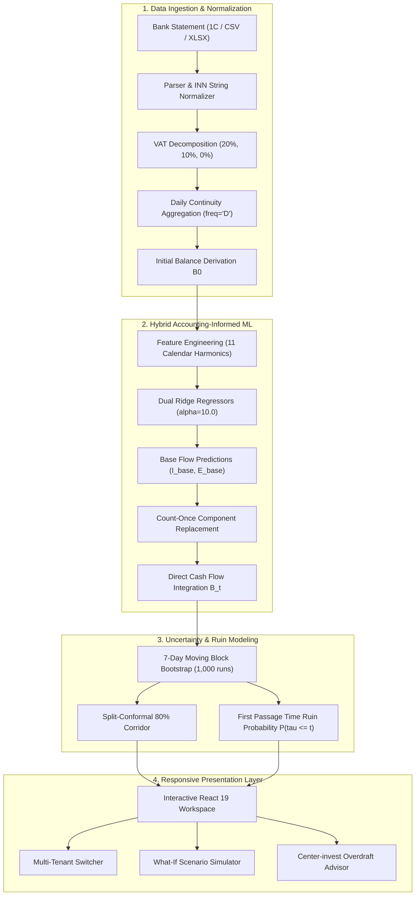

# Bank «Center-invest» Cash Flow Intelligence Platform

[](https://github.com/ijstt/centrinvest-cashflow/actions/workflows/ci.yml)
[](https://fastapi.tiangolo.com)
[](https://react.dev)
[](https://www.typescriptlang.org)
[](https://tailwindcss.com)
[](LICENSE)

An enterprise-grade, high-fidelity financial analytics and liquidity forecasting platform for small and medium enterprises (SME), built for the **Bank «Center-invest» Hack RND 2026** challenge.

The platform implements an **Accounting-Informed Machine Learning (AIML)** architecture combining the **Direct Cash Flow Method**, regularized calendar regression (Ridge $\ell_2$), non-parametric **Split-Conformal Prediction (80% corridor)**, and **First Passage Time (FPT)** ruin probability modeling via 7-day Moving Block Bootstrap.

---

## Key Capabilities

1. **Multi-Format Statement Ingestion**:
   - Universal parsing of Russian bank statements: 1C:ClientBankExchange (`1CClientBankExchange`), CSV (BOM, UTF-8, CP1251, `;` / `,` / `\t`), Excel (`.xlsx`).
   - Strict string preservation of Russian Taxpayer Identification Numbers (INN) with leading zeroes (`'0068275202'`).
   - Multi-rate Russian VAT (*НДС*) decomposition (20%, 10%, 0%, exempt).
   - Atomic idempotency and composite transaction deduplication (`date + doc_number`).

2. **Regulatory Calendar Intelligence**:
   - **Labor Code Art. 136 (*ТК РФ*)**: Semi-monthly payroll cadence detection (~15-day interval).
   - **Tax Code Art. 6.1 (*НК РФ*)**: Consolidated Unified Tax Payment (*ЕНП*) scheduled on the 28th with official Russian Government holiday & weekend bridge roll (Decrees 2024 #1314, 2025 #1335, 2026).

3. **Hybrid Cash Flow & ML Forecasting**:
   - **Direct Cash Flow Invariant**: $B_t = B_{t-1} + I_t - E_t = B_0 + \sum_{k=1}^t (I_k - E_k)$.
   - **Component-Based Identity Replacement (Count-Once Invariant)**: Replaces baseline recurring expenses with planned contracts without double-counting.
   - **Ridge Calendar Regression**: $\ell_2$-regularized model ($\\alpha = 10.0$) trained on 11 orthogonal calendar features (one-hot weekdays, intra-month harmonics, intra-year seasonality).

4. **Stochastic Liquidity Risk & First Passage Time**:
   - **7-day Moving Block Bootstrap (1,000 iterations)**: Preserves intra-week error autocorrelation.
   - **First Passage Time Ruin Probability**: $P(\\tau \le t) = P(\\exists s \le t: B_s < 0)$.
   - **Split-Conformal Prediction**: Nominal 80% corridors calibrated on held-out past observations. Independent temporal backtests report empirical coverage.

5. **Starred Capabilities (*Задачи со звездочкой*)**:
   - **Multi-Tenant Profile**: Multi-company workspace switching per user with complete ledger isolation.
   - **Interactive What-If Simulation**: 4 stress dimensions (revenue drop 10-30%, receivable delay 14-28d, lump-sum expense, fixed cost increase).
   - **Plan-Actual Variance Analysis**: Weekly and daily categorical reconciliation.
   - **AI Financial Advisor**: Prescriptive recommendations (pre-approved Bank Center-invest overdraft credit limit calculation at $1.25 \times \Delta_{\\max}$, payment deferral, receivables factoring).

---

## Architectural Overview



---

## Quickstart

### Option 1: Docker Compose (Full Stack in 1 Command)

```bash
# Clone the repository
git clone https://github.com/ijstt/centrinvest-cashflow.git
cd centrinvest-cashflow

# Copy environment template
cp .env.example .env

# Launch entire platform
docker compose up -d --build
```

Access the services:
- **Web UI**: `http://localhost/`
- **Backend API Docs (Swagger)**: `http://localhost:8000/docs`
- **PostgreSQL**: `localhost:5432`

### Option 2: Local Development Setup

#### Backend

```bash
cd backend
python3 -m venv .venv
source .venv/bin/activate
pip install -e ".[dev]"

# Run database migrations
python ../scripts/migrate_database.py

# Seed demo tenant accounts
python ../scripts/seed_demo_data.py

# Launch FastAPI development server
uvicorn src.main:app --host 0.0.0.0 --port 8000 --reload
```

#### Frontend

```bash
cd frontend
npm install
npm run dev
```

---

## Verification & Test Suite

The verification suite includes **170 backend tests** and **31 frontend tests**, with backend acceptance also verified against an isolated PostgreSQL instance. See [release remediation](docs/RELEASE_REMEDIATION_20261025.md) for behavior, evidence and limitations.

```bash
# Run entire test suite (backend + frontend)
make test

# Or run individual verification suites:
PYTHONPATH=backend pytest backend/tests/
cd frontend && npm test
npm run build
```

---

## Independent Control Dataset Evaluation

For banking risk analysts and curators conducting checkpoint evaluations:

```bash
python scripts/evaluate_control_dataset.py --file fixtures/statements/C001_logistics.csv
```

Outputs step-by-step audit logs, 3-model benchmark comparison, Confusion Matrix, MAE, MSE, Accuracy, Precision, Recall, F1, WAPE, Brier Score, and saves JSON summaries.

---

## Default Demo Credentials

| Role | Email | Password | Assigned Companies |
| :--- | :--- | :--- | :--- |
| **Demo User** | `demo@centrinvest.ru` | `password123` | ООО «Грузоперевозки-063» (Logistics) |
| **CFO User** | `client@centrinvest.ru` | `password123` | ООО «Донские Продукты» (Retail), ИП «Южный Ремонт» (Construction) |

---

## License

This project is licensed under the MIT License - see the [LICENSE](LICENSE) file for details.
